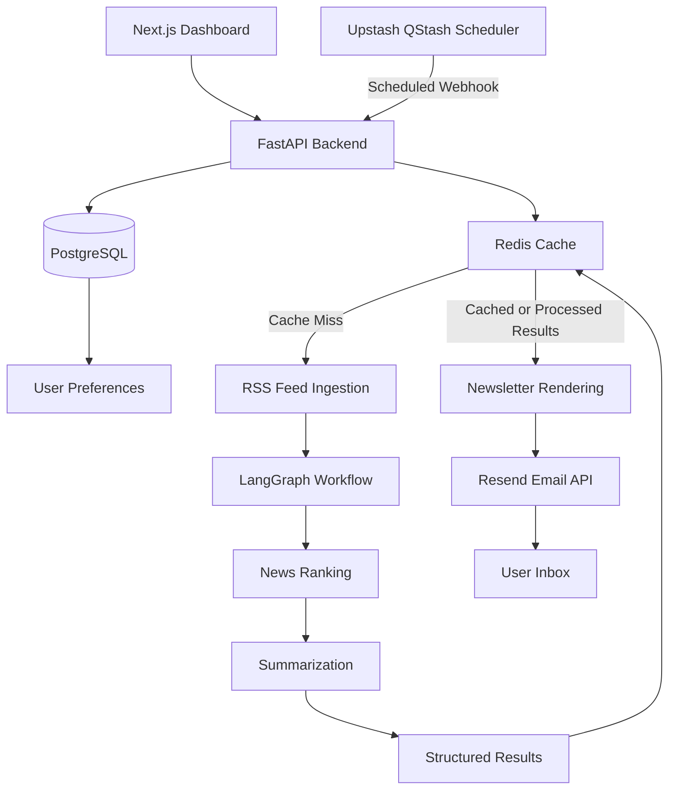

# Digest

**Personalized AI-Powered News Aggregation and Newsletter Delivery**

Digest is an AI-powered news aggregation platform that collects articles from RSS feeds, ranks them according to user interests, generates concise summaries, and delivers personalized newsletters on a configurable schedule.

Built with FastAPI, LangGraph, PostgreSQL, and Upstash, Digest combines AI-driven content processing with caching and event-driven scheduling to reduce redundant computation and operational overhead.

## Key Features

- **Personalized News Aggregation:** Collect articles from multiple RSS and Atom feeds.
- **AI-Powered Ranking:** Prioritize news according to user-selected topics and preferences.
- **Structured Summarization:** Generate concise summaries using LLM-powered workflows.
- **Intelligent Caching:** Reuse processed news to reduce redundant AI inference and API consumption.
- **Scheduled Delivery:** Trigger newsletter processing through Upstash QStash webhooks.
- **Email Delivery:** Generate HTML newsletters using React Email and send them through Resend.
- **Persistent User Configuration:** Store user preferences and delivery settings in PostgreSQL.
- **Serverless-Oriented Architecture:** Use event-driven execution without requiring an always-running background worker.
- **Cost-Aware Processing:** Minimize repeated computation through deterministic cache keys and configurable expiration policies.

## Architecture



### System Components

| Component | Responsibility |
|---|---|
| Next.js | User dashboard and configuration interface |
| TypeScript | Frontend type safety |
| FastAPI | Backend APIs, orchestration, and webhook processing |
| LangGraph | Stateful orchestration of the AI processing workflow |
| Groq / Google Gemini | LLM inference, subject to provider availability and quotas |
| `feedparser` | RSS and Atom feed parsing |
| `httpx` | HTTP requests for feed retrieval and content extraction |
| BeautifulSoup | Optional HTML parsing and article-content extraction |
| PostgreSQL | Persistent user configuration and delivery state |
| Upstash Redis | Caching structured news results |
| Upstash QStash | Scheduled execution and webhook delivery |
| React Email | Newsletter template generation |
| Resend | Email submission and delivery integration |

## News Processing Workflow

1. **Scheduling:** QStash triggers the backend according to the configured delivery schedule.
2. **Configuration Retrieval:** The backend retrieves the relevant user preferences from PostgreSQL.
3. **Cache Lookup:** A deterministic cache key is generated from the relevant configuration and news time window.
4. **News Ingestion:** When reusable cached results are unavailable, the system retrieves articles from configured RSS and Atom feeds.
5. **AI Processing:** LangGraph coordinates the ranking, summarization, and structuring of retrieved articles.
6. **Cache Storage:** Processed results are cached in Redis with a configurable time-to-live.
7. **Newsletter Rendering:** The selected articles are rendered into an HTML newsletter using React Email.
8. **Email Dispatch:** Resend handles email submission and returns the result to the backend for delivery tracking.

The workflow is designed to reuse processed results whenever the cached data remains valid for the requested configuration and news time window.

## Caching Strategy

Digest uses Upstash Redis to reduce unnecessary AI processing.

A cache key should represent the inputs that materially affect the generated digest, including:

- Selected topics and preferences
- Feed or source configuration
- Language and regional preferences, where applicable
- News retrieval time window
- Processing or prompt version, when necessary

Configuration values are normalized before generating the cache key. Cached results expire according to a configurable TTL, allowing fresh news to be processed periodically.

### Expected Benefits

- Reduced redundant LLM calls
- Lower inference costs
- Faster responses for cache hits
- Reduced repeated processing across users with equivalent configurations

Caching is an optimization rather than a substitute for correct freshness policies. Digest must avoid reusing results when the relevant inputs or news time window differ.

## Scheduling and Reliability

Digest uses Upstash QStash to trigger scheduled processing through HTTP webhooks.

This approach avoids maintaining a continuously running scheduler or background worker solely for recurring newsletter delivery.

The backend is designed to support the following reliability measures:

- Webhook signature verification
- Idempotent dispatch processing
- Retry handling for transient failures
- Delivery status tracking
- Bounded execution and timeouts for external API calls
- Graceful handling of feed, model, cache, and email provider failures

Because webhook delivery may be retried, dispatch operations should not assume that every request represents a new scheduled delivery. Persistent delivery records and idempotency keys are required to prevent duplicate processing and duplicate email submissions.

## Technology Stack

### Frontend
- Next.js
- TypeScript

### Backend
- Python
- FastAPI
- LangGraph
- LangChain integrations

### Data and Infrastructure
- PostgreSQL
- Upstash Redis
- Upstash QStash

### AI and Email
- Groq API
- Google Gemini API as an alternative provider
- Resend
- React Email

### Deployment
- Vercel or another compatible Next.js hosting platform
- A compatible Python hosting platform for FastAPI
- Managed PostgreSQL and Upstash services

Actual hosting choices depend on runtime compatibility, execution limits, and available free-tier quotas.

## RSS Sources

The initial set of supported feeds includes:

| Publisher | Feed URL |
|---|---|
| TechCrunch | https://techcrunch.com/feed/ |
| The Verge | https://www.theverge.com/rss/index.xml |
| BBC World News | http://feeds.bbci.co.uk/news/world/rss.xml |
| Hacker News | https://news.ycombinator.com/rss |

Additional feeds can be introduced through configuration rather than hardcoding source-specific processing logic.

Feed availability and article completeness may vary. The ingestion pipeline should handle malformed entries, unavailable sources, duplicate articles, and missing article content without failing the entire digest.

## Project Structure

The following represents the intended high-level repository structure.

```text
digest/
├── frontend/
│   ├── app/
│   ├── components/
│   ├── lib/
│   ├── public/
│   └── package.json
│
├── backend/
│   ├── main.py
│   ├── agent_pipeline.py
│   ├── requirements.txt
│   └── .env.example
│
├── .gitignore
└── README.md
```

The directory structure may evolve as application modules, tests, database migrations, and deployment configuration are added.

## Getting Started

### Prerequisites

Install or configure the following:

- Python 3.11 or a version compatible with the selected dependencies
- Node.js and npm
- PostgreSQL
- An Upstash Redis database
- An Upstash QStash account
- An API key for a supported LLM provider
- A Resend account for email delivery

Free-tier availability and service limits depend on the provider's current terms.

### 1. Clone the Repository

```bash
git clone <your-repository-url>
cd digest
```

### 2. Configure the Backend

```bash
cd backend

python -m venv .venv
```

Activate the virtual environment.

**Windows:**

```bash
.venv\Scripts\activate
```

**Linux or macOS:**

```bash
source .venv/bin/activate
```

Install the Python dependencies:

```bash
pip install -r requirements.txt
```

Create a `.env` file using `.env.example` as a reference.

Configure the required environment variables before starting the backend.

### 3. Configure Environment Variables

Example configuration:

```dotenv
# Application
APP_ENV=development

# PostgreSQL
DATABASE_URL=

# Upstash Redis
REDIS_URL=

# LLM Provider
GROQ_API_KEY=
GEMINI_API_KEY=

# Upstash QStash
QSTASH_TOKEN=
QSTASH_CURRENT_SIGNING_KEY=
QSTASH_NEXT_SIGNING_KEY=

# Resend
RESEND_API_KEY=
EMAIL_FROM=

# Frontend
FRONTEND_URL=
```

Use only the variables required by the selected implementation and deployment configuration. Add any other required database or provider settings as the application evolves.

Never commit real API keys, passwords, signing keys, or other credentials to version control.

### 4. Start the Backend

From the backend directory, run:

```bash
uvicorn main:app --reload
```

The FastAPI development server should be available at:

```text
http://127.0.0.1:8000
```

Interactive API documentation is available at:

```text
http://127.0.0.1:8000/docs
```

### 5. Configure the Frontend

From the repository root:

```bash
cd frontend
npm install
npm run dev
```

Open the local address printed by the Next.js development server.

Configure the frontend to communicate with the FastAPI backend using the appropriate environment settings.

## API Overview

The backend is responsible for user configuration, scheduled processing, cache management, and newsletter delivery.

| Endpoint | Purpose |
|---|---|
| `POST /api/...` | Register or update user configuration, according to the implemented routes |
| `POST /api/trigger-digest` | Trigger digest processing through the backend |
| `GET /docs` | Explore the FastAPI API documentation |

The exact configuration endpoints should be documented as they are finalized in `main.py`. The QStash-triggered endpoint must verify webhook signatures before processing scheduled requests.

## Security Considerations

- Store secrets in environment variables or the hosting provider's secret manager.
- Never expose backend credentials to the frontend.
- Verify QStash webhook signatures before accepting scheduled requests.
- Validate user input on the backend.
- Restrict CORS to trusted frontend origins in production.
- Use parameterized database operations and appropriate database permissions.
- Apply reasonable request timeouts and limits to external feed and API calls.
- Avoid logging API keys, credentials, or unnecessary personal information.
- Protect user configuration and delivery records with appropriate access controls.

## Testing and Observability

The project should be validated at both the component and end-to-end levels.

Important test cases include:

- RSS feed parsing and malformed entries
- Article normalization and duplicate detection
- Cache key consistency and TTL expiration
- Ranking and summary output validation
- Webhook authentication and idempotency
- Database failures and provider timeouts
- Retry handling and duplicate dispatch prevention
- Email template rendering and dispatch outcomes

Useful operational metrics include:

- Cache hit rate
- Articles retrieved and processed per run
- LLM requests per digest
- Processing latency, including p50 and p95
- Ranking quality on a labeled evaluation dataset
- Workflow failure and retry rates
- Email submission and delivery outcomes

These measurements provide evidence of performance, reliability, and cost efficiency beyond whether the application works for a single demonstration.

## Cost Considerations

Digest is designed to target a zero-cost deployment using available free tiers.

The main cost-control mechanisms are:

- Redis caching to avoid redundant LLM inference
- RSS and HTTP-based ingestion rather than browser automation
- Event-driven scheduling rather than continuously running workers
- Bounded LLM calls and request timeouts
- Reuse of structured results when the cache remains valid

A permanent zero-cost deployment is not guaranteed. Provider quotas, model availability, request limits, database limits, and hosting policies may change. The system should handle quota exhaustion and temporary provider unavailability gracefully.

## Roadmap

- [ ] Complete the user configuration dashboard
- [ ] Finalize PostgreSQL schema and database migrations
- [ ] Implement preference-aware cache key generation
- [ ] Add article normalization and duplicate detection
- [ ] Implement ranking and summary evaluation
- [ ] Add webhook signature verification and idempotent dispatches
- [ ] Implement delivery status tracking and failure recovery
- [ ] Add automated tests for critical processing paths
- [ ] Deploy the frontend and backend
- [ ] Validate scheduled end-to-end newsletter delivery
- [ ] Publish performance and cache-efficiency measurements

## Project Goals

Digest aims to demonstrate practical engineering across:

- AI workflow orchestration
- Information retrieval and relevance ranking
- API and database design
- Caching and cost optimization
- Event-driven serverless execution
- Reliable webhook processing
- External service integration
- Testing, observability, and deployment

The focus is not only on generating AI summaries, but on building a reliable application around AI processing.

## License

Choose and add an appropriate license before distributing the project publicly.